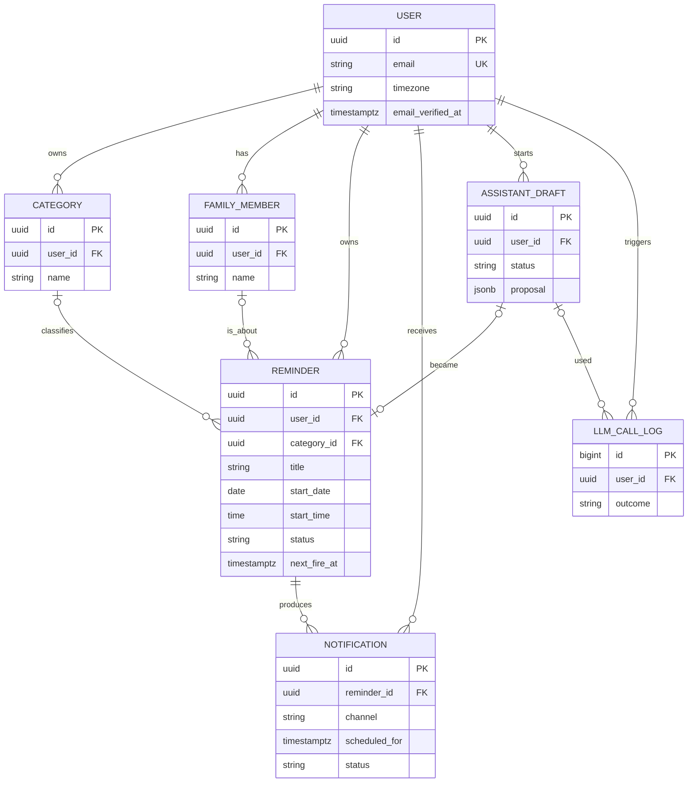

# MOMent AI — Database Design

**Document version:** 0.1 (planning) · **Date:** 24 Nov 2026
**Database:** PostgreSQL · **Related documents:** `requirements.md`, `architecture.md`, `user-stories.md`

This document describes the **logical design**: tables, columns, rules, indexes and data lifecycle. It deliberately contains **no SQL scripts and no Django migrations**; you will create those from this design during implementation. Types are written in PostgreSQL terms with the usual Django field in brackets as a hint.

---

## 1. Design principles

1. **Everything belongs to a user.** Every row can be traced to exactly one owner. This makes permission checks and account deletion simple.
2. **UUID primary keys** for all tables exposed through the API (hard to guess, safe in URLs).
3. **Store the instant in UTC, store the intent in local terms.** `next_fire_at` is a UTC timestamp for fast "what's due?" queries; `start_date` + `start_time` keep what the user actually asked for ("9:00 every day").
4. **The database enforces important rules too**, not just Python: foreign keys, unique constraints, check constraints. If a bug slips through the application, the database is the last line of defence.
5. **Minimise personal data.** Only first names/nicknames for family members; no birth dates, locations or phone numbers (PRV-01).
6. **Drafts are not reminders.** AI proposals live in their own table and become reminders only on confirmation.
7. **Logs hold metadata, not content.** The LLM log table never stores prompts or responses (LLM-05).
8. **Hard delete.** When the user deletes something, it is really deleted (PRV-06). No "soft delete" flags in MVP.

---

## 2. Entity-relationship diagram

**How to read it:** "one user owns many categories" (`||--o{`). `|o--o{` means "optional": a reminder may have no category and no family member. A draft may or may not have become a reminder.

---

## 3. Enumerated values

Store enums as short strings with a check constraint (or Django `TextChoices`). Avoid native Postgres ENUM types, which are awkward to change.

| Enum | Values |
|---|---|
| `family_member.relation` | `child`, `partner`, `parent`, `other` |
| `reminder.recurrence_frequency` | `none`, `daily`, `weekly`, `monthly`, `yearly` |
| `reminder.status` | `active`, `completed` |
| `reminder.source` | `manual`, `assistant` |
| `notification.channel` | `in_app`, `email` |
| `notification.status` | `pending`, `sent`, `failed`, `skipped` |
| `assistant_draft.status` | `clarifying`, `ready`, `confirmed`, `cancelled`, `expired`, `failed` |
| `llm_call_log.outcome` | `proposed`, `clarified`, `declined`, `validation_error`, `api_error`, `timeout` |

Weekday numbers: **0 = Monday … 6 = Sunday** (the same convention as Python's `datetime.weekday()` and `dateutil`).

---

## 4. Tables

### 4.1 `users`  (custom user model — `accounts` app)

> **Create the custom user model before your very first migration.** Django lets you add a custom user model easily at the start and makes it extremely painful later.

| Column | Type | Null | Notes |
|---|---|---|---|
| `id` | uuid | no | PK |
| `email` | varchar(254) | no | Login identifier. Stored lower-cased; **unique**. (There is no separate username.) |
| `password` | varchar(128) | no | Django's salted hash; never the plain password |
| `display_name` | varchar(80) | no | |
| `timezone` | varchar(64) | no | IANA name such as `Asia/Kolkata`; validated against the system timezone database |
| `email_verified_at` | timestamptz | yes | Null = unverified. Email notifications require non-null (AUTH-03) |
| `notify_email` | boolean | no | Default true |
| `notify_in_app` | boolean | no | Default true |
| `terms_accepted_at` | timestamptz | no | Consent record (PRV-03) |
| `is_active` | boolean | no | Default true |
| `is_staff`, `is_superuser` | boolean | no | Django admin flags; default false |
| `last_login` | timestamptz | yes | |
| `created_at`, `updated_at` | timestamptz | no | |

**Constraints:** unique `email`; check that `email = lower(email)` (or enforce in the application and index on `lower(email)`).

### 4.2 `categories`  (`categories` app)

| Column | Type | Null | Notes |
|---|---|---|---|
| `id` | uuid | no | PK |
| `user_id` | uuid | no | FK → users, **ON DELETE CASCADE** |
| `name` | varchar(40) | no | |
| `color` | varchar(7) | no | Hex such as `#F59E0B` |
| `icon` | varchar(30) | yes | An icon key or emoji (optional) |
| `sort_order` | smallint | no | Display order |
| `created_at` | timestamptz | no | |

**Constraints:** unique on (`user_id`, `lower(name)`); maximum 30 per user is enforced in the application (cheaper than a database trigger).
**Seeding:** the registration service creates the eight defaults (Kids & School, Health & Doctor, Home & Chores, Meals & Groceries, Bills & Money, Birthdays & Events, Personal, Other) in the same transaction as the user.

### 4.3 `family_members`  (`categories` app) — Should-have

| Column | Type | Null | Notes |
|---|---|---|---|
| `id` | uuid | no | PK |
| `user_id` | uuid | no | FK → users, ON DELETE CASCADE |
| `name` | varchar(60) | no | First name or nickname only |
| `relation` | varchar(10) | no | `child`, `partner`, `parent`, `other` |
| `created_at` | timestamptz | no | |

**Constraints:** unique on (`user_id`, `lower(name)`); maximum 20 per user in the application.

### 4.4 `reminders`  (`reminders` app) — the central table

| Column | Type | Null | Notes |
|---|---|---|---|
| `id` | uuid | no | PK |
| `user_id` | uuid | no | FK → users, ON DELETE CASCADE |
| `category_id` | uuid | yes | FK → categories, **ON DELETE SET NULL** (deleting a category must not delete reminders; they show "Uncategorized") |
| `family_member_id` | uuid | yes | FK → family_members, ON DELETE SET NULL |
| `title` | varchar(120) | no | |
| `notes` | varchar(500) | no | Empty string when none |
| `start_date` | date | no | Local date of the first occurrence, as the user chose |
| `start_time` | time (no seconds) | no | Local wall-clock time |
| `recurrence_frequency` | varchar(10) | no | Default `none` |
| `recurrence_interval` | smallint | no | Default 1; "every N" |
| `recurrence_weekdays` | smallint[] | no | Default empty; used for `weekly`. Empty on a weekly rule means "the weekday of `start_date`" |
| `recurrence_end_date` | date | yes | Last date the rule may produce an occurrence (inclusive) |
| `status` | varchar(10) | no | `active` or `completed` |
| `next_fire_at` | timestamptz | yes | **UTC.** The next occurrence to notify. Null only when `completed` |
| `last_fired_at` | timestamptz | yes | When the latest notification was created |
| `completed_at` | timestamptz | yes | Set when `status` becomes `completed` |
| `source` | varchar(10) | no | `manual` or `assistant` |
| `created_at`, `updated_at` | timestamptz | no | |

**Consistency rules (database check constraints where practical, always in the serializer):**
1. `recurrence_interval` between 1 and 52.
2. Every value in `recurrence_weekdays` is between 0 and 6, with no duplicates.
3. If `recurrence_frequency = 'none'` → interval = 1, weekdays empty, end date null.
4. `recurrence_weekdays` may be non-empty only when frequency is `weekly`.
5. `recurrence_end_date` is null or ≥ `start_date`.
6. `status = 'active'` ⇒ `next_fire_at` is not null.
7. `status = 'completed'` ⇒ `next_fire_at` is null and `completed_at` is not null.
8. Title length 1–120; notes ≤ 500 (also in the serializer).
9. A **one-time** reminder must be at least one minute in the future when created or when its date/time is edited (application rule — it depends on "now", so it cannot be a table constraint).

**Behavioural notes**
- A reminder has **no per-occurrence rows.** Occurrences are *computed* from the rule; only the *next* one is stored (`next_fire_at`). Past firings live in `notifications`.
- After a firing, the scheduler sets `next_fire_at` to the next future occurrence, or completes the reminder.
- The user's timezone is **not copied** into the reminder; it is read from the user's profile. If the user changes timezone, active reminders keep their wall-clock time and `next_fire_at` is recalculated.

### 4.5 `notifications`  (`notifications` app)

One row = one delivery of one occurrence on one channel.

| Column | Type | Null | Notes |
|---|---|---|---|
| `id` | uuid | no | PK |
| `user_id` | uuid | no | FK → users, ON DELETE CASCADE (denormalised from the reminder to make "my notifications" one fast query) |
| `reminder_id` | uuid | no | FK → reminders, **ON DELETE CASCADE** (deleting a reminder removes its history; this also means a queued email for a deleted reminder finds nothing to send) |
| `channel` | varchar(10) | no | `in_app` or `email` |
| `scheduled_for` | timestamptz | no | The occurrence time (UTC) this notification is about |
| `title_snapshot` | varchar(120) | no | Title at the time, so a list stays readable if the reminder is renamed |
| `status` | varchar(10) | no | `pending`, `sent`, `failed`, `skipped`. For `in_app`, `sent` is set immediately at creation |
| `attempt_count` | smallint | no | Default 0 (email retries) |
| `last_error` | varchar(200) | yes | Short, sanitised error text; never message content |
| `sent_at` | timestamptz | yes | |
| `read_at` | timestamptz | yes | In-app only; null = unread |
| `created_at` | timestamptz | no | |

**Constraints:** **unique on (`reminder_id`, `scheduled_for`, `channel`)** — this is what guarantees "exactly once" (NOT-04). The scheduler inserts rows and ignores a conflict if one already exists.

### 4.6 `assistant_drafts`  (`assistant` app)

| Column | Type | Null | Notes |
|---|---|---|---|
| `id` | uuid | no | PK |
| `user_id` | uuid | no | FK → users, ON DELETE CASCADE |
| `status` | varchar(12) | no | See enums |
| `messages` | jsonb | no | Ordered list of turns: role (`user`/`assistant`), text, time. Capped at 7 turns, each ≤ 500 chars for user turns |
| `pending_question` | text | yes | Latest clarification question and its suggested options (when `clarifying`) |
| `proposal` | jsonb | yes | Latest **validated** proposal: the fields plus the `assumptions` list |
| `clarification_rounds` | smallint | no | 0–3 |
| `reminder_id` | uuid | yes | FK → reminders, ON DELETE SET NULL, **unique** — set at confirmation; the uniqueness is the second layer of protection against double creation |
| `error_code` | varchar(40) | yes | Set when `failed` |
| `expires_at` | timestamptz | no | Created + 1 hour, extended on each user turn |
| `created_at`, `updated_at` | timestamptz | no | |

**Privacy note:** `messages` contains raw user sentences (possibly child names or health appointments). It is deleted after 7 days (PRV-05).

### 4.7 `llm_call_logs`  (`assistant` app) — metadata only

| Column | Type | Null | Notes |
|---|---|---|---|
| `id` | bigint identity | no | PK, internal only, never exposed |
| `user_id` | uuid | no | FK → users, ON DELETE CASCADE |
| `draft_id` | uuid | yes | FK → assistant_drafts, ON DELETE SET NULL |
| `provider` | varchar(30) | no | |
| `model` | varchar(60) | no | |
| `outcome` | varchar(20) | no | See enums |
| `input_tokens`, `output_tokens` | integer | yes | Cost tracking |
| `latency_ms` | integer | yes | |
| `created_at` | timestamptz | no | |

**Never stored:** prompts, user text, model output. This table answers "how much did the AI cost, how often did it fail, how slow was it?" and nothing else.

---

## 5. Tables you get from libraries (not designed by you)

| Table(s) | From | Notes |
|---|---|---|
| `django_session` | Django sessions | Server-side sessions; purge expired ones periodically (Django's clear-sessions command, or add to the daily cleanup job) |
| `django_migrations`, `django_content_type`, `auth_permission`, `django_admin_log` | Django core/admin | Standard |
| Celery | — | Beat schedule is defined in code, and the broker is Redis, so Celery adds **no** tables |
| Email verification and password-reset tokens | Django signing | Signed time-limited tokens, so no tables |
| Throttle counters | Redis cache | Not in PostgreSQL |

---

## 6. Indexes and the queries they serve

Rule of thumb: create an index **for a query you can name**. Each index speeds reads and slows writes slightly, so don't add speculative ones.

| Table | Index | Serves |
|---|---|---|
| `users` | unique on `email` | Login lookup |
| `categories` | unique on (`user_id`, `lower(name)`) | Duplicate check; list per user |
| `family_members` | unique on (`user_id`, `lower(name)`) | Same |
| `reminders` | **partial** index on `next_fire_at` **where** `status = 'active'` | **The scheduler's "what is due?" query** — small and very fast because completed reminders are excluded |
| `reminders` | (`user_id`, `status`, `next_fire_at`) | "My upcoming reminders, soonest first" |
| `reminders` | (`user_id`, `category_id`) | Filter by category |
| `reminders` | (`user_id`, `completed_at` desc) *(optional)* | Completed list, newest first |
| `notifications` | unique (`reminder_id`, `scheduled_for`, `channel`) | Exactly-once guarantee (doubles as the lookup by reminder) |
| `notifications` | partial index on (`user_id`, `created_at` desc) **where** `channel = 'in_app'` | Notification list |
| `notifications` | partial index on (`user_id`) **where** `channel = 'in_app'` **and** `read_at IS NULL` | Unread badge count |
| `notifications` | partial index on (`created_at`) **where** `channel = 'email'` **and** `status = 'pending'` | The scheduler's "stuck email" sweep |
| `assistant_drafts` | (`user_id`, `created_at` desc) | Recent drafts per user |
| `assistant_drafts` | (`expires_at`) | Expiry and cleanup |
| `llm_call_logs` | (`user_id`, `created_at`) | Per-user usage; cleanup by date |

**The four queries that matter most**

1. **Scheduler pick-up:** active reminders with `next_fire_at <= now`, oldest first, limit 200, row-locked with skip-locked.
2. **Upcoming list:** my active reminders ordered by `next_fire_at`, filtered by category, paged by 25.
3. **Unread count:** count of my unread in-app notifications.
4. **Daily cleanup:** delete drafts older than 7 days; LLM logs older than 90 days; notifications older than 90 days; clear expired sessions.

**Tip for learning:** once you have real tables, use `EXPLAIN ANALYZE` on query 1 and 2 with a few thousand test rows. Seeing "Index Scan" instead of "Seq Scan" is the best way to understand why these indexes exist.

---

## 7. Data lifecycle and retention

| Data | Created when | Deleted when |
|---|---|---|
| User | Registration | User deletes the account (immediate, cascades to everything below) |
| Categories / family members | Seeding at signup / user adds | User deletes, or account deleted (cascade) |
| Reminders | Manual creation or draft confirmation | User deletes, or account deleted. Completed reminders are kept until deleted |
| Notifications | Scheduler | Cascade with the reminder or user; otherwise cleaned **90 days** after creation |
| Assistant drafts | First assistant message | Cleaned **7 days** after creation (drafts expire for use after 1 hour); cascade with the user |
| LLM call logs | Each model call | Cleaned **90 days** after creation; cascade with the user |
| Sessions | Login | Expire after 14 days; cleaned regularly |
| Backups | Daily | Rotated within 30 days (so deleted accounts disappear from backups within 30 days — PRV-06) |

**Account deletion cascade** (one user row delete removes everything): `users` → `categories`, `family_members`, `reminders`, `notifications`, `assistant_drafts`, `llm_call_logs`. Because every table has `user_id` with `ON DELETE CASCADE`, deletion needs no special code beyond deleting the user and clearing sessions. Write a test that creates a full set of data for two users, deletes one, and asserts the other's data is untouched and nothing of the first remains.

---

## 8. Design decisions explained

| Decision | Reasoning |
|---|---|
| **Local date + time + user timezone, plus UTC `next_fire_at`** | Users think in wall-clock time ("every day at 9:00"). If you stored only UTC, a daylight-saving change would silently move the reminder by an hour. Storing the next UTC instant separately keeps the scheduler query trivially fast. |
| **Only the next occurrence is stored** | Storing every future occurrence of "every day, forever" is impossible; computing on demand is cheap and always consistent with the rule. |
| **Separate recurrence columns instead of an RRULE string** | You can validate, display and edit columns directly, and the LLM only has to produce a few simple fields. A library (`dateutil`) converts columns to a rule when computing dates. |
| **`category_id` nullable with SET NULL** | Deleting a category must not destroy reminders (CAT-03). "Uncategorized" is just a null. |
| **`notifications` is a separate table** | A reminder is the *plan*; notifications are the *history of deliveries*. Separating them lets recurring reminders have many deliveries, gives us the unique constraint for exactly-once, and powers the in-app list without extra bookkeeping. |
| **Unique (`reminder_id`, `scheduled_for`, `channel`)** | The database refuses duplicates no matter how many workers run. Application code alone is never enough for exactly-once behaviour. |
| **`user_id` repeated on notifications** | Mild denormalisation: "my unread notifications" is a single-table query and permission check. |
| **Drafts stored in a table (not in memory/Redis)** | Survive restarts; one place for expiry and privacy cleanup; can be audited without storing LLM prompts in logs. |
| **JSONB for `messages` and `proposal`** | These are small, shaped by the LLM and always read as a whole; a normalised table would add joins for no benefit. Anything you need to *query* (status, expiry, user) is a normal column. |
| **`llm_call_logs` without content** | Gives cost and quality visibility while honouring data minimisation. |
| **UUID keys** | Cannot be enumerated; safe to expose in URLs and logs. Slightly larger than integers, irrelevant at this scale. |
| **No soft deletes** | Matches "delete means delete" (PRV-06) and avoids having to remember `WHERE deleted = false` everywhere. |
| **Enums as strings with check constraints** | Easier to evolve than native Postgres ENUMs; readable in the database. |
| **Sessions in Postgres** | One fewer moving part than Redis sessions; the load is tiny. |

---

## 9. Growth path (not in the MVP)

| Future feature | Schema change, in outline |
|---|---|
| **Shared household** | New `households` and `household_members` (user, role) tables; add `household_id` to categories, family members and reminders; permission checks become "is the user a member of this household?". Move data by creating one household per existing user. |
| **Push notifications** | New `push_subscriptions` table; add `push` to `notification.channel`. |
| **Per-occurrence exceptions** | New `reminder_exceptions` table: (`reminder_id`, `occurrence_date`, `action` = skipped / moved, `new_start`). |
| **Snooze** | Add `snoozed_until` to notifications or reminders; scheduler honours it. |
| **Edit/delete by sentence** | No schema change; assistant drafts gain a `kind` (create / update / delete) and a `target_reminder_id`. |
| **Languages** | Add `locale` to users; prompts selected by locale. |

---

## 10. Illustrative data (for understanding only)

Assume today is Tue 24 Nov 2026, 10:00, user timezone `Asia/Kolkata`. (India has no daylight saving; local time is UTC+05:30.)

**Reminder A — one-time:** "Call the pediatrician", category *Health & Doctor*, `start_date` 2026-11-25, `start_time` 09:00, frequency `none`, status `active`, `next_fire_at` = 2026-11-25 03:30 UTC (that is 09:00 local), source `assistant`.

**Reminder B — weekdays:** "School pick-up", *Kids & School*, `start_date` 2026-11-24, `start_time` 15:30, frequency `weekly`, interval 1, weekdays `[0,1,2,3,4]`, no end date, `next_fire_at` = 2026-11-24 10:00 UTC (15:30 local).
After it fires on Tuesday, the scheduler sets `next_fire_at` to Wednesday 25 Nov 10:00 UTC. After Friday's firing it jumps to Monday 30 Nov, skipping the weekend.

**Reminder C — monthly bill:** "Pay electricity bill", *Bills & Money*, `start_date` 2026-12-05, `start_time` 10:00, frequency `monthly`, interval 1, `next_fire_at` = 2026-12-05 04:30 UTC.

**Notifications for Reminder B's first firing:** two rows — (B, 2026-11-24 10:00 UTC, `in_app`, `sent`) and (B, 2026-11-24 10:00 UTC, `email`, `pending` → `sent`). Trying to insert either row a second time is rejected by the unique constraint.

**Draft that produced Reminder A:** `status` `confirmed`, `reminder_id` = A's id, `messages` holding the sentence and the assistant's replies, `proposal` holding the validated fields and `assumptions` such as an empty list. After 7 days the draft row is cleaned up; the reminder remains (its `source` = `assistant` is all that is left of the connection).
